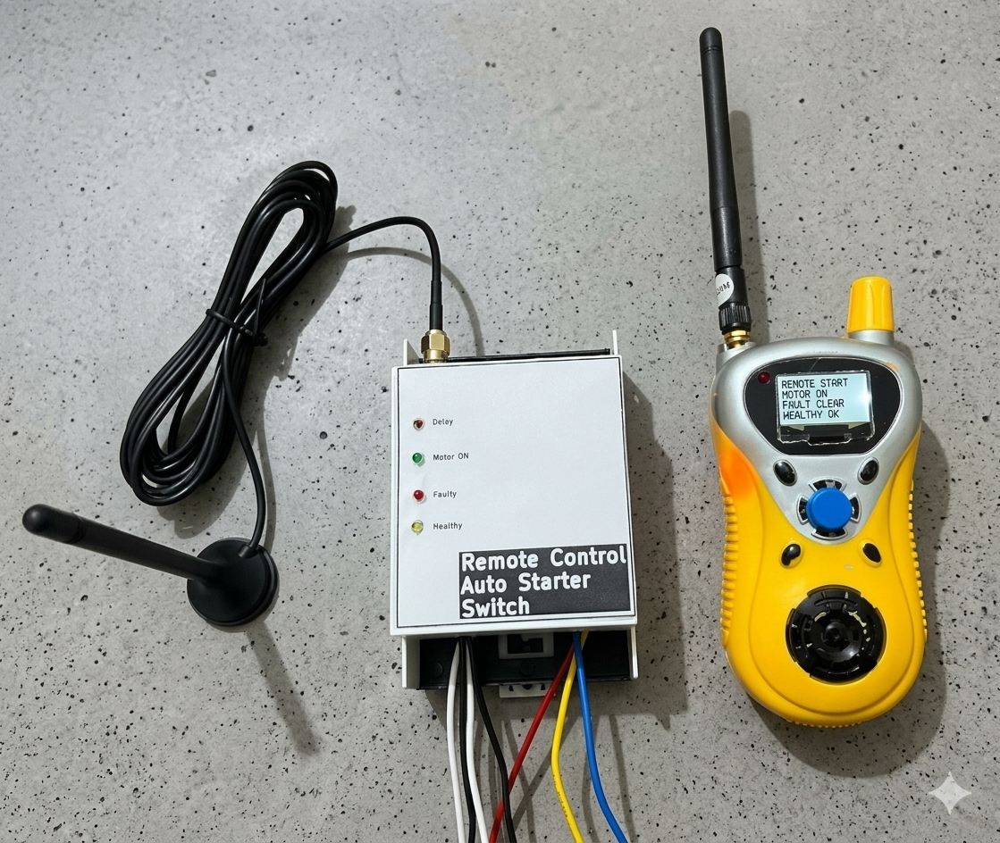

# Remote Control DOL Auto Switch

### Industrial Automation | Agricultural Applications | Embedded Product Development

## Project Overview

The Remote Control DOL Auto Switch is an embedded control solution developed for remote operation of agricultural and industrial motor starter systems.

The product consists of a motor-side control unit and a dedicated handheld remote controller, enabling convenient remote motor operation and monitoring of system conditions.

The solution is designed to simplify motor operation, improve accessibility, and provide visual feedback about motor and controller status.

## Product Prototype

*Developed hardware prototype featuring the motor-side control unit and handheld remote controller.*

## Key Features

- Remote motor START/STOP operation.
- Dedicated handheld remote controller.
- Motor operating status indication.
- System health indication.
- Fault status indication.
- Delay status indication.
- Integration with existing DOL motor starter systems.
- Designed for agricultural and industrial applications.

## Status Indicators

| Indicator | Function |
|---|---|
| Delay | Delay operating status |
| Motor ON | Motor running indication |
| Faulty | Fault status indication |
| Healthy | System health indication |

## Applications

- Agricultural water pump systems.
- Industrial motor control.
- Remote operation of motor-driven equipment.
- Agricultural automation.
- Industrial automation systems.

## My Contribution

Responsible for product engineering and development activities:

- Embedded firmware development.
- Hardware integration.
- Remote control functionality.
- Motor starter interface integration.
- Hardware debugging and testing.
- System integration and prototype validation.

## Project Status

**Working hardware prototype developed.**

## Future Development

- Enhanced remote monitoring.
- Advanced operational diagnostics.
- Additional monitoring capabilities.
- Product scalability and improved usability.

## Confidentiality Notice

This project represents proprietary product development work.

Internal hardware architecture, circuit diagrams, PCB designs, firmware source code, component specifications, and implementation details are intentionally not disclosed.

## Developer

**Mangesh Tarate**  
Firmware Engineer | Embedded Systems | Industrial Automation

- LinkedIn: [Mangesh Tarate](https://www.linkedin.com/in/mangesh-tarate-46170a1b8)
- GitHub: [GitHub Profile](https://github.com/mangesh-tarate)
- Email: mangesh.tarate014@gmail.com

---

*Developing practical embedded solutions for industrial and agricultural automation.*
